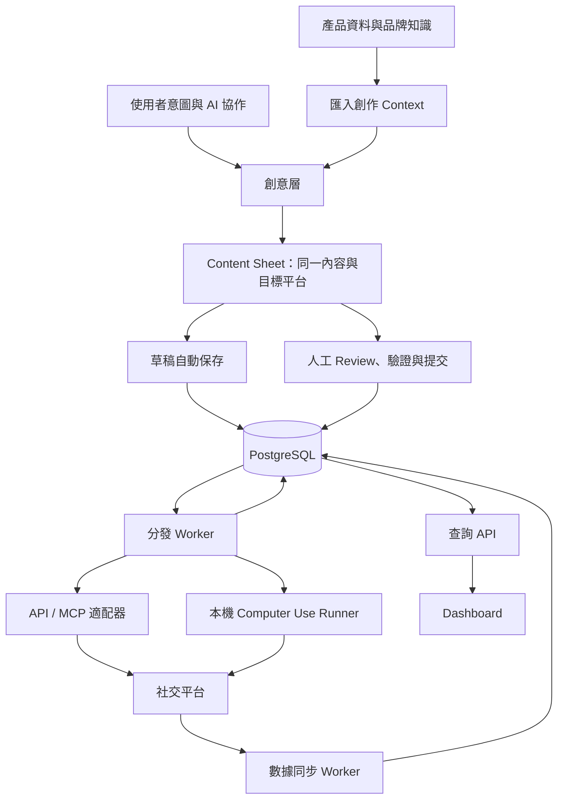

# ProjectPROMO

AI 輔助宣傳 SaaS：從創意與匯入的產品 context 生成宣傳物料，填入標準內容表單，提交分發工作，再集中追蹤跨平台帖子與成效。

## 狀態與已確認方向

已實作可運行的 X／Facebook Page 單工作區 pilot。啟動、現有能力與限制見 [RUNNING.md](RUNNING.md)。以下保留完整產品需求及目標架構；規劃項目不代表全部已實作。

目前實際技術：React／TypeScript／Vite、Node／Express、PostgreSQL 或本機 PGlite、SQL 工作佇列、DeepSeek adapter、本機素材儲存。Drizzle、pg-boss、多租戶及平台付費額度尚未落地。

- 產品形態為整合 SaaS，第一個使用者是自己，長期服務創作者、品牌與代營運團隊。
- 首批平台：X、Facebook 商業帳號；Facebook 是否具體為 Page 尚待確認。
- 創意層與分發層隔離，以資料庫中的標準內容契約交接。
- 創作支援人類與 AI 協作，將產品資料匯入 context window 後生成物料；持久化 RAG 產品庫的範圍另行確認。
- 一張 Content Sheet 是一篇內容，可選多個分發平台，共用同一份內容與素材。需要平台專屬內容時，在創意層複製／衍生另一張 Sheet，選擇對應平台。
- 表單包含預定時間、目標平台及帳號，提交後等待分發處理。
- 分發結果回寫資料庫，包括每平台狀態與帖子 URL。
- 獨立數據同步流程取得平台指標並回寫；Dashboard 從資料庫讀取。
- 生成結果預設草稿；human review 確認後才提交分發。先前全自動提交構想不納入目前流程；批准後的排程、分發與同步自動執行。
- 創意層可預覽各目標平台效果；主要介面為 Content Sheet 與旁側 AI chatroom。
- 草稿自動保存至資料庫 table；品牌常駐 context 可保存與重用。
- Sheet 只包含確定要發佈的素材，候選素材留在創意工作區。
- 支援逐張預覽、勾選多張 Sheet 後批次人工確認提交。
- 同時支援用戶自帶 API Key（BYOK）與平台提供的付費額度。
- 接受部分成功與人工接手、排查及修復。
- 整合優先 MCP / API；缺少可用介面時，僅對平台允許的操作評估本機 computer use，控制 token 成本；X 停用非 API 自動化。
- 文字、圖片、影片、computer use 與 embedding 模型可依能力更換 API 供應商。

## 第一版模型與媒體範圍（已確認）

- 文字生成與創意 agent 大腦使用 DeepSeek；使用者已有 API Key，第一個帳號可使用 BYOK。具體 model ID 配置化，接入時以帳號實際可用模型驗證。
- SaaS chatroom 的後端 runtime 呼叫 DeepSeek，處理工具執行、結果回傳與多步循環；DeepSeek 不直接取得資料庫存取權。
- 第一版圖片與影片由人工上傳／選取並加入 Sheet，支援保存、預覽、排序、移除與平台格式檢查。
- 圖片／影片生成 provider 接口預留，暫不接入實際生成服務。使用者正在試驗 zimage 與 minimax H3 workflow（名稱依使用者描述，尚未驗證接口）。
- 第一版 agent 可協助寫圖片／影片提示詞或腳本、選取已上傳素材；沒有媒體生成能力時明確顯示需人工加入，不回報已生成。
- 預留 MediaGenerationProvider 的能力查詢、提交、狀態查詢及結果取得契約；未配置時標記 unavailable，不向 agent 暴露可執行的生成工具。
- 人工上傳的 Asset 與未來生成的 Asset 使用同一引用格式，分別記錄來源；人工素材不需要虛構 provider job。
- 同時支援 BYOK／平台額度的產品方向保留；平台額度所用憑證與商業收費方案另行配置。

## 平台規則研究

參見 [社交平台規則與整合分析](platform-rules.md)（2026-09-15）：X、Facebook 為首版，另比較 Instagram、TikTok、YouTube、LinkedIn。

- X 官方明確禁止非 API 自動化；X 不啟用 computer use 備援，失敗核對後重試或交人類手動處理。
- Computer use 僅對逐項確認允許的「平台 × 操作」啟用；登入與可模擬操作不等於平台允許。
- 通用 Sheet 保留單份內容，但目標可包含平台專屬 publishing_options（可見性、互動設定與商業揭露等），不屬於文案版本。
- Facebook Page Token 流程已由 Meta 官方 Postman 文件確認；發文／Insights 權限及媒體細則仍待補驗證。

## 系統結構

先採模組化單體與獨立 worker 程序；邏輯分層，不急於拆成多個微服務。瀏覽器與本機 runner 經授權 API 存取資料，不直接連資料庫。

### 1. 創意層

- 輸入：意圖、產品、受眾、語言、品牌語氣、參考素材與活動條件。
- 互動創作：AI 生成及修改，使用者可編輯每個欄位與素材。
- 一鍵創作：使用匯入的 context 生成內容，填入草稿 Content Sheet。
- 平台適配：複製／衍生新 Sheet，調整內容並重新選擇目標平台；以 derived_from_sheet_id 保留來源關係，後續編輯互不影響。
- 預覽：用同一 Sheet 呈現各平台的預估效果與格式限制；預覽不保證與平台最終 UI 完全一致。
- 輸出：可版本化的內容，不直接呼叫發佈工具。
- 平台文案、媒體裁切及其他會改變表達的調整在提交前完成；分發層只做已定義的技術轉換與檢查。

### 創作工作室互動規格

已確認的畫面與行為：

- 首次使用、沒有知識庫或 context 時，Sheet 為空白，旁側顯示 AI chatroom；可直接手動填寫或對話提出需求。
- 有品牌常駐 context 時，先預顯示相關 context，供本次創作使用；不因選中品牌就自動發佈。
- 使用者在 chatroom 提需求，agent 可修改及填入 Sheet，而不是只回覆可複製的文字。
- 草稿修改自動保存至資料表，UI 顯示儲存中／已儲存／失敗；失敗時保留未保存內容並支援重試。
- 確定發佈的素材加入 Sheet；候選圖片、影片及歷史生成結果保留在創意工作區。
- 平台預覽在創意層完成；需要不同內容時衍生另一張 Sheet。

已確認 TAB 用於接受欄位灰字預填建議：建議內容在接受前不屬於正式欄位，接受後才寫入草稿並自動保存。TAB 不觸發生成或批准發佈。建議需綁定目標 Sheet、欄位及 revision；欄位改動後舊建議失效。

已確認一段對話可管理多張 Sheet，由 agent 依意圖自由建立、衍生與修改多篇草稿。創意層以 agent 協作工作區為核心；不是每張 Sheet 各綁一個 agent。已確認由 SaaS 內的 chatroom 完成上述操作，agent runtime 在 SaaS 後端執行；用戶無需另接外部 agent。

建議實作規則：

- Agent 透過結構化欄位更新介面修改草稿，更新包含 sheet_id、預期 revision 與欄位變更；後端驗證後保存。
- 顯示 agent 改了哪些欄位並提供撤銷；不用每次修改都跳批准視窗，正式提交仍需 human review。
- 人類與 agent 同時修改時以 revision 檢查衝突，避免較晚返回的 AI 結果覆蓋使用者新輸入。
- ChatSession 與 ContentSheet 為多對多關係，透過 SessionSheet 關聯。介面顯示本次涉及及正在修改的 Sheet；agent 每次寫入必須明確指定目標 ID。
- 使用者可在同一對話要求建立多篇，再選定其中幾篇修改；對象不明時先確認範圍。
- TAB 只在有可接受灰字建議且焦點位於相應欄位時攔截；其他情況維持鍵盤焦點移動，並提供滑鼠接受按鈕。
- 對話明確要求的 agent 修改可直接寫入草稿並顯示變更；主動欄位補全則先顯示灰字，按 TAB 才寫入，兩者採不同互動。

### Agent 控制方式

已確認採 SaaS chatroom 驅動的多 Sheet 創意工作區。以下為建議實作方式，將 agent runtime 與產品業務工具分離：

- Chatroom 是指令與進度介面；agent runtime 在後端規劃並呼叫工具，不在 React 內持有金鑰或直接寫資料庫。
- 第一版創意工具包含讀取品牌 context、查詢／建立／複製 Sheet、更新指定欄位、選取已上傳素材與取得預覽。媒體生成工具待實際 provider 接入後啟用。
- 多步生成保存 AgentRun 與工具執行紀錄，可顯示進度、取消後續步驟、恢復與核對結果；取消不保證撤銷已送出的供應商工作。
- 每個寫入通過 workspace 權限、schema、revision 與去重檢查。自由建立多篇草稿仍受費用、步數及工作數上限約束。
- Agent 可填入建議平台與排程時間；正式批准與建立分發工作由人工提交服務處理，創意 agent 不持有批准發佈能力。
- 核心能力先封裝成穩定的應用服務／工具介面；之後可經授權 API 或 MCP 暴露給外部 agent，沿用同樣的權限與 human review 邊界。
- SaaS 自帶後端 agent，使用者直接在 chatroom 完成創作操作。外部 agent 的 API／MCP 接入列為後續擴充，不是第一版使用前提。
- 更換語言模型與更換 agent runtime 分開設計；工具呼叫、圖片／影片能力與訊息格式需由 adapter 驗證。

### 2. Content Sheet：層與層之間的契約

一張表單只保存一份內容，不設平台文案 overrides 或 PlatformVariant。資料庫拆分內容、目標、工作及結果，避免共用一個狀態欄位。

| 分組 | 建議欄位 |
| --- | --- |
| 識別與來源 | id、workspace_id、brand_id、campaign_id（可選）、derived_from_sheet_id、schema_version、revision、context_snapshot_id |
| 共通內容 | title、body、tags、locale、link、location（可選） |
| 媒體 | asset_refs、類型、順序、alt text、處理狀態；檔案位於物件儲存 |
| 分發目標 | platform、account_id、scheduled_at、原始 timezone；引用同一份內容快照 |
| 控制 | draft/approved 狀態、批准版本、reviewed_by、reviewed_at、created_by |

- 空值與不支援欄位明確區分；平台不支援 location 或 title 時，提交前提示處理方式。
- 同一表單可以有多個目標帳號，各目標可以有自己的時間。
- UI 可以顯示總狀態，但結果從各目標工作計算。
- 提交後凍結內容快照；修改草稿不影響既有排程。修改排程內容需新版本並安全取代尚未執行的工作。
- 不把任意 JSON 視為有效輸入；同一內容需通過所有所選平台的 schema 與能力驗證。不相容時在創意層調整或衍生新 Sheet，不由分發層偷偷改寫。

### 3. 提交與排程

- 生成預設草稿，人工 review 確認是進入分發佇列的必要條件。
- 草稿自動保存至 ContentSheet table，不能被分發 worker 領取。人工提交時才建立批准快照與 PublishJob。
- 支援逐張 review 後勾選多張批次提交；提交摘要列出內容版本、帳號與時間，逐張顯示驗證結果。
- 建議批次內有無效 Sheet 時先阻擋該次提交；用戶修正或取消勾選後再提交，避免默默漏掉某張。
- 批次 review 期間若內容版本改變，該張必須重新確認。
- 驗證素材已完成、帳號能力、必填欄位、媒體格式、時間與批准版本。
- 一個目標帳號對應一個 PublishJob；每個 job 引用不可變內容版本。
- 業務工作與佇列事件在同一資料庫交易建立；若佇列整合不能共用交易，使用 transactional outbox。
- 唯一提交鍵防止重複點擊產生重複工作；UTC 儲存執行時間，保留使用者時區。

### 4. 分發層

- Worker 領取到期工作，取得租約，檢查帳號及平台能力後執行。
- 平台 adapter 統一提供 validate、publish、reconcile 與 getMetrics 等操作；不支援的操作明確標記。
- 優先使用經驗證的 API / MCP；MCP 的實際能力仍受底層權限與配額限制。
- 回寫 platform_post_id、canonical_url、published_at、執行渠道與必要原始回應；URL 尚未取得時另行補查。
- 工作狀態：queued / scheduled → running → succeeded / retry_wait / failed / needs_attention / cancelled。
- 外部發佈成功但回寫中斷是可能事件；先 reconcile，再决定是否重試。佇列去重不保證外部發佈恰好一次。
- 暫時錯誤採有限退避重試；登入與權限問題、未知發佈結果交人工處理。
- 人工補發需登記平台 ID / URL 並關聯原工作。
- 已成功的目標不隨其他目標失敗而重發；已在執行中的取消只能盡力處理，取消不能撤回已發帖。

### 5. 數據同步與 Dashboard

- 獨立 Metrics Worker 依 platform + account_id + platform_post_id 定位帖子；URL 供查看與人工查核，不作唯一資料索引。
- 優先經平台 API 取得指標；必要時評估其他已驗證渠道，不把讀取網址等同於能取得全部指標。
- 儲存原始指標、來源、取得時間、統計區間與可比較的標準欄位。
- MetricSnapshot 保留歷史，用於觀看／曝光、回覆、按讚、分享、點擊等趨勢。
- 各平台依定義顯示；曝光不可當作跨平台去重人數，不同指標不能盲目相加。
- 缺失數據顯示不可用或過期，不當作零。同步失敗不改變發佈成功狀態。
- 新帖較頻繁同步，舊帖降低頻率；手動刷新也經背景工作，受配額與預算限制。
- Dashboard 只經查詢 API 讀資料庫；日常刷新不呼叫 LLM。AI 分析另作按需工作。
- 轉換與營收分析需要追蹤連結、網站事件／訂單資料及歸因規則，不能僅從帖子 URL 推得。

### 6. 創意 Context 與產品資料

- 已確認在創意層匯入資料至模型 context window；具體匯入形式尚待確認。
- Context 包含使用者意圖、產品事實、品牌要求、參考素材與對話；每次生成記錄使用的來源快照與模型。
- 匯入方式候選為貼文字、上傳文件／媒體或網址；只有經實作支援的來源才能解析，不預設模型能直接讀任意檔案或連結。
- 依所選模型計算輸入預算並保留輸出空間。超限時提示選取、摘要或分批處理，不靜默截斷。
- 已確認 context 可跨創作重用，品牌常駐 context 可預先帶入並顯示；保留期限與匯入檔案類型待定。
- 品牌 context 與本次創作 context 分開保存。建議當次修改只影響本次創作，需明確選擇才更新品牌常駐版本。
- 每次生成保存實際使用的 context 快照；品牌更新不回頭改寫已生成或已批准內容。
- 直接匯入 context 與 RAG 檢索是不同流程；目前不把向量資料庫設為第一版必需依賴。
- 若未來加入 RAG，先限制 workspace／品牌再檢索；來源與 embedding 模型版本需可追溯。
- 價格、優惠等事實保留來源；資料不足時標示缺失，交人工 review，不自行補造。

### 7. SaaS 與本機 Computer Use Runner

- SaaS 負責帳號、資料、排程與協調；雲端 API 工作不依賴用戶電腦在線。
- 本機 runner 主動連接 SaaS，以裝置授權領取指定 workspace／帳號的工作。
- 瀏覽器登入狀態保留本機；runner 不持有資料庫憑證，也不接收任意 shell 指令。
- 工作具備租約、心跳、結果回報及執行上限；同一帳號避免併發 UI 操作。
- 裝置離線顯示等待裝置；超過發佈期限的補發政策待確認。
- 登入驗證、UI 改版或超出步數／費用上限時轉人工；computer use 不是保證成功的萬用渠道。
- API 發佈結果未知時，不直接切换 runner 再發送。

## 建議技術棧（待確認）

| 層級 | 建議 | 理由 |
| --- | --- | --- |
| Web | React + TypeScript + Vite | 創作工作室、表單、排程與 Dashboard |
| 後端 | Node.js + TypeScript | 共用 schema，封裝提交、權限與平台服務 |
| 業務資料 | PostgreSQL + Drizzle | SaaS 多租戶、交易、內容版本與指標歷史 |
| Context | 匯入、解析、token 預算與來源快照 | 先支援創意層 context window；持久化檢索確定需要後再加入 pgvector |
| 背景佇列 | pg-boss + 獨立 workers | 基於 PostgreSQL 處理非同步與排程，減少初期基礎設施 |
| 媒體 | S3 相容物件儲存 | 大型圖片／影片不進資料庫，保存 metadata 與受控 URL |
| 本機 runner | Node.js，需 GUI 時可包裝 Electron | 本機登入、人工接管與裝置狀態 |
| 模型 | DeepSeek 文字與工具呼叫 adapter | 首版文字與 agent 已選定；圖片／影片 provider 預留接口，其他能力後續配置 |

由先前的本機 SQLite 建議改為 SaaS PostgreSQL；第一版仍可自用部署，但資料與授權按 workspace 隔離。雲端供應商、認證服務、版本與部署區域待定。

## AI 設定與成本

- ProviderConfig 包含供應商、base URL、model ID、能力、憑證引用、逾時及用量上限。
- 相容協定共用 adapter；不相容 API 需專用 adapter，任意 URL 不代表相容全部能力。
- 圖片／影片生成接口預留提交、查詢、保存結果與取消能力探測；第一版僅人工素材，不執行媒體生成請求。
- GenerationJob / UsageRecord 保存模型、輸入版本、產出、估計與實際費用。
- 每 workspace 與每工作設預算；平台 API、生成模型與 computer use 分別計費及追蹤。
- 憑證加密保存在後端憑證系統，不出現在前端 bundle 或一般日誌。
- 已確認同時支援平台付費額度與 BYOK；每次生成工作固定使用其中一種，記錄 funding_source、provider 與憑證引用。
- BYOK 失效或平台額度不足時，明確報錯；不在未授權情況下切換付費來源。
- 平台額度工作先預留預算，完成後依可取得的實際用量結算；未知費用保持待核對，避免重試重複扣款。
- BYOK 模型費由供應商向用戶收取；本 SaaS 的儲存／服務收費政策另定。

## 核心資料實體

Workspace、Membership、Brand、SocialAccount、BrandContextVersion、ContextSource、ContextSnapshot、ChatSession、ChatMessage、SessionSheet、AgentRun、SheetSuggestion、SheetChange、ContentSheet、ContentVersion、Asset、Approval、PublishJob、PublishAttempt、PlatformPost、MetricSnapshot、Device、ProviderConfig、GenerationJob、UsageRecord。

業務資料與物件存取均受 workspace 權限控制；單人使用也建立隔離邊界。保留審計、備份與工作恢復能力。

## 交付順序與驗收

1. 平台能力驗證：確認 X / FB 帳號類型、授權、發佈及可取得指標；真實測試發佈內容另行指定。
2. 契約與閉環：Content Sheet → 提交 → 分平台工作 → 狀態及帖子 ID / URL → 指標快照 → Dashboard。
3. 創意與 context：DeepSeek 對話與工具呼叫、context 重用、文案生成、Sheet 衍生、Tab 補全與平台預覽；圖片／影片人工加入。
4. 自動化與 runner：排程、批准政策、裝置離線、人工接管、費用上限。
5. SaaS 完整化：多租戶權限驗證、配額、備份、營運監控；計費及轉換分析按需求加入。
6. 後續媒體擴充：待 workflow 試驗完成再接圖片／影片生成 provider，沿用 Asset 與 Sheet 契約。

關鍵驗收：兩平台部分成功不重發；回寫失敗可核對；重啟可恢復；修改草稿不影響批准版本；同步失敗不改發佈結果；context 不跨租戶；更換模型可追溯；人工補發可關聯。

## 待討論的關鍵決策

1. SaaS 部署區域、認證服務與首版上線期限？
2. Context 首批支援哪些匯入形式（貼文字、文件／媒體、網址），保留多久？
3. DeepSeek 具體 model ID、每次 agent 工作及每月用量上限？
4. 品牌常駐 context 建議僅透過明確的「更新品牌 context」操作修改，是否符合預期？
5. Facebook 是否為 Page；是否已有開發者 App？
6. 每日發文量、影片頻率、同步頻率與預算；第一版上線期限？
7. 本機 runner 離線錯過排程時，自動補發或等人工確認？
8. 是否追蹤既有歷史帖子；是否已有網站與訂單資料？

## 查證與參考

2026-09-15：X 官方文件列出發文與指標 API，採按量計費，部分私有指標取得有時間限制；實際能力仍需帳號驗證。Facebook 文件本輪未成功讀取，尚未驗證其權限與指標。

- [X 發佈](https://docs.x.com/x-api/posts/create-post)
- [X 指標](https://docs.x.com/x-api/fundamentals/metrics)
- [X 定價](https://docs.x.com/x-api/getting-started/pricing)
- [Vite](https://vite.dev/guide/)
- [Drizzle](https://orm.drizzle.team/docs/get-started)
- [pg-boss](https://github.com/timgit/pg-boss)
- [pgvector](https://github.com/pgvector/pgvector)

### DeepSeek 接入查證（2026-09-15）

官方文件提供 Tool Calls；模型回傳工具名稱與參數，應用後端驗證並執行，再回傳工具結果。首版用此方式操作 Sheets。若使用 thinking mode，adapter 需依所選 API 文件正確延續工具呼叫上下文。尚未以用戶金鑰測試連線，不預設已取得模型權限。

- [DeepSeek Tool Calls](https://api-docs.deepseek.com/guides/tool_calls/)
- [DeepSeek Chat Completions](https://api-docs.deepseek.com/api/create-chat-completion/)
